# writing-flow

`writing-flow` checks writing style and information flow for Claude Code and
Codex. It runs as a Claude Code plugin, a Codex hook adapter, or a Python CLI.
The runtime uses only the Python standard library.

## Install as a Claude Code plugin

Install the repository through Claude Code's plugin manager. Validate the
plugin from its repository root with `claude plugin validate .`. The plugin
loads its hook scripts from its own directory, so it does not need a pip
install.

## Install with pip

Use Python 3.10 or later:

```sh
python3 -m pip install .
```

The package installs the `writing-flow` command.
Install it separately on each distro. The command and its Python environment
belong to that distro, even when this repository lives on shared storage.

## CLI

Run the checker on files or directories:

```sh
writing-flow check README.md AGENTS.md docs/rules.md docs/configuration.md docs/provenance.md docs/parity.md skills rules output-styles agents commands
```

The checker accepts text files, folders, URLs, stdin, `--text`, and `--clip`.
The checker uses `--as chat` for chat-form and response-flow checks. The checker
returns 1 when a blocking finding exists, 0 when no blocking finding exists, and
2 for usage or fetch errors. Run `writing-flow sweep` to review older prose.
Run `writing-flow report` to review flow-gate outcomes.

## Hooks

Claude Code hooks are registered in `hooks/hooks.json`. Codex file changes run
through `adapters/codex/run_hook.py`. The standalone state directory defaults
to `~/.claude/writing-flow/state/` in Claude Code and
`~/.codex/writing-flow/state/` in Codex.

Do not install this plugin while harness-kit remains active. Both packages
would run the same writing hooks in one turn.

See [configuration](docs/configuration.md), [rules](docs/rules.md), and
[source provenance](docs/provenance.md) for details.

## Before and after

These excerpts come verbatim from the saved A/B outputs. The long pair uses the matching revalidation section from each reply.

### Short — weekly sync email
**Raw**
```markdown
**Subject:** Weekly sync moving to Thursday afternoons from 1 December

Hi team,

From 1 December, our weekly engineering sync will move from **Monday at 09:00** to **Thursday at 14:00**.

Please let me know if you have any objections or significant scheduling conflicts by **Friday**. Otherwise, we’ll proceed with the new time.

The existing Monday calendar invite will be cancelled, and a new invite for Thursdays will follow.

Thanks,  
[Your name]
```
`writing-flow check`: 2 findings, 0 blocking and 2 advisory. Findings: conversational address, courtesy close.

**Writing-flow**
```markdown
**Subject:** Weekly engineering sync — objections by Friday

Hi team,

Our weekly engineering sync will move from Monday at 09:00 to Thursday at 14:00, starting 1 December.

If this creates a conflict, please raise it by Friday. I’ll cancel the existing Monday calendar invite and send a new Thursday invite.

Feedback welcome.
```
`writing-flow check`: 0 findings, 0 blocking and 0 advisory.

The plugin keeps the date and action clear while shortening the subject and body.

### Medium — API key rotation how-to
**Raw**
```markdown
# Rotate an API key with zero downtime

This procedure assumes the service reads its API key from an environment variable, has two replicas behind a load balancer, and the API provider permits the old and new keys to remain valid at the same time.

1. **Create a new key** at the API provider. Do not revoke the current key yet.
2. **Store the new value** in the secret source used to populate the service environment (for example, a secret manager or deployment secret). Keep the environment-variable name unchanged, such as `THIRD_PARTY_API_KEY`.
3. **Roll the two replicas one at a time.** Update the first replica so new processes receive the new environment value, then restart or replace it. Wait until it is healthy and serving traffic through the load balancer.
4. **Verify the first replica** can authenticate to the provider. Check its health checks, application logs, and a representative API request.
5. **Update the second replica** in the same way. Keep the first replica in service while the second is restarted or replaced. Confirm both replicas are healthy and use the new key.
6. **Monitor traffic and errors** for a short, agreed observation period. Roll back by restoring the old secret and restarting replicas one at a time if authentication failures occur.
7. **Revoke the old key** only after the observation period ends and no workloads still use it. Remove any old-key references from secret stores, deployment history, and runbooks.

## Important notes

- Environment variables are normally read only when a process starts; updating a secret store alone does not update a running replica.
- Maintain at least one healthy replica in the load balancer at every step. Respect connection draining or termination-grace settings before replacing a replica.
- If the provider does not support overlapping active keys, coordinate a maintenance window or use a provider-supported credential migration mechanism; true zero-downtime rotation is not otherwise possible.

```
`writing-flow check`: 4 findings, 4 blocking and 0 advisory. Findings: 2 semicolon errors and 2 long sentence errors.

**Writing-flow**
```markdown
# Rotate an API key without downtime

Rotate the key with a rolling deployment. Keep both keys valid until every replica uses the new key.

## Create and store the new key

1. Create a new API key in the provider console.
2. Give the key a name that includes its creation date.
3. Store the new key in the secret that supplies the service environment variable.
4. Keep the existing key active at the provider.

For example, update `API_KEY` in the secret store. Do not place either key in source control, logs, or deployment output.

## Replace the replicas

1. Start a rolling deployment after you update the secret.
2. Configure the deployment to replace one replica at a time.
3. Wait for the replacement replica to pass its load-balancer health check.
4. Confirm that the new replica can call the API with the new key.
5. Repeat until both replicas run the new version.

The load balancer keeps a healthy old replica in service while the other replica starts. Do not restart both replicas at once.

## Retire the old key

1. Check that both running replicas started after the secret update.
2. Check application logs and API metrics for authentication failures.
3. Wait for the old replicas to drain and stop.
4. Revoke the old key at the provider.
5. Record the rotation date and key identifier in the service runbook.

If the new key fails, restore the old secret value before you revoke the old key. The old key remains the rollback path until the deployment is healthy.

```
`writing-flow check`: 0 findings, 0 blocking and 0 advisory.

The plugin turns the rotation into a safer ordered procedure with health checks and rollback.

### Long — HTTP caching policy
**Raw**
```markdown
## A useful default mental model

| Resource type | Typical policy |
|---|---|
| Hashed JS/CSS/image/font files | `public, max-age=31536000, immutable` |
| HTML entry page | `no-cache` plus ETag |
| Public data that may be briefly old | `public, max-age=<short duration>` plus ETag |
| Private, user-specific data | `private, max-age=<short duration>` or `private, no-cache` |
| Sensitive data that must not persist in caches | `no-store` |

In short: use **`max-age`** to avoid requests during a period where old content is acceptable; use **`no-cache` with an ETag** when you need the server to approve every reuse but still want to avoid downloading unchanged response bodies.
```
`writing-flow check`: 2 findings, 2 blocking and 0 advisory. Findings: semicolon and long sentence.

**Writing-flow**
```markdown
## A practical backend policy

Start by grouping responses by how stale they may be:

| Response type | Typical policy |
|---|---|
| Hashed JavaScript, CSS, images | `public, max-age=31536000, immutable` |
| Public data that may be briefly stale | `public, max-age=60` or `max-age=300`, plus ETag |
| User-specific data that may be briefly stale | `private, max-age=60`, plus ETag |
| Data that must be checked every time | `private, no-cache`, plus ETag |
| Sensitive data that must not persist in caches | `no-store` |

For most APIs, use an ETag alongside a meaningful `max-age`. `max-age` avoids unnecessary requests during the freshness window. The ETag makes the first request after that window cheap when the representation has not changed.
```
`writing-flow check`: 0 findings, 0 blocking and 0 advisory.

The plugin pairs freshness guidance with concrete cache policies and an ETag validation rule.

## How it works

```mermaid
flowchart TD
  subgraph WritePath[Write path]
    W[Model Write or Edit] --> S[guard_style]
    S -->|pass| F[guard_flow]
    S -->|logged one-shot waiver| SL[Log waiver]
    SL --> F
    S -->|block with fix| SF[Model fixes write]
    SF --> S
    F -->|pass| E[guard_prompt_echo]
    F -->|logged one-shot waiver| FL[Log waiver]
    FL --> E
    F -->|block with fix| FF[Model fixes write]
    FF --> F
    E -->|pass| Saved[Write proceeds]
    E -->|logged one-shot waiver| EL[Log waiver]
    EL --> Saved
    E -->|block with fix| EF[Model fixes write]
    EF --> E
    Saved --> Advice[style_check and guard_doc_residue advise afterwards]
  end

  subgraph ReplyPath[Reply path]
    Stop[Reply at Stop] --> Audit[response_audit]
    Audit --> RF[Flow gate]
    RF --> Form[Chat form]
    Form --> Style[Personal style]
    Style --> Ground[Grounding]
    Ground --> Echo[Prompt echo]
    Echo --> Cap[At most one block per reply]
  end

  subgraph EvalLoop[Eval loop]
    Check[writing-flow check] --> Gates[Evaluation gates]
    AB[A/B harness] --> Gates
    Parity[parity_check] --> Gates
    Shape[shape_check] --> Gates
    EchoEval[echo_eval] --> Gates
  end
```


